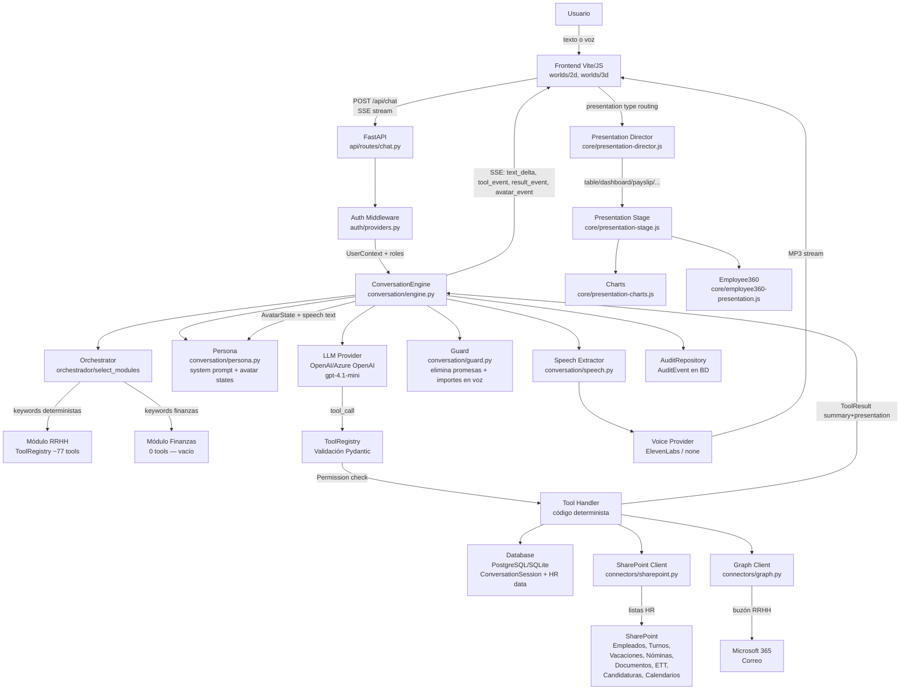

# 03 - Mapa de Arquitectura Funcional

## Flujo End-to-End



---

## Flujo Detallado del Motor de Conversación

```
1. POST /api/chat { session_id, message }
2. engine.py: cargar historial (MAX 12 turnos) + estado de sesión
3. orchestrator.select_modules(message) → set de módulos activos
4. Filtrar ToolRegistry por permisos del usuario → tools disponibles para este turno
5. LLM round 1 (con herramientas): decide qué tool(s) llamar
6. Para cada tool_call:
   a. Validar parámetros con Pydantic
   b. Verificar Permission (user.has(permission))
   c. Ejecutar handler async
   d. Registrar AuditEvent
   e. Actualizar estado de sesión (foco, último resultado, última tabla)
7. LLM round 2 (sin herramientas): sintetiza respuesta conversacional
   a. Persona inyecta system_prompt con contexto
   b. rules_for_prompt() añade reglas activas (NOM-002, SEL-001, etc.)
8. Guard limpia promesas imposibles e importes del texto
9. SpeechExtractor extrae texto para locución
10. Persona determina AvatarState
11. SSE stream: text_delta*, tool_event*, result_event (presentation), avatar_event, speech_event
12. Guardar turno en BD (ConversationTurn)
```

---

## Flujo de Sincronización de Datos

```
Cronjob / startup:
SharePoint API → SharePointClient → Ingestor → Mappers (hr.py) → PostgreSQL
  ↓
  Empleados, Turnos (ShiftDay), Vacaciones, Nóminas (metadatos),
  Documentos firmados, ETT, Candidaturas (con embeddings), Calendarios
  
Freshness:
  Cada tool verifica "stale_after_minutes=30" y avisa si los datos pueden no estar al día.
```

---

## Saltos Rotos / Puntos de Riesgo

| Punto | Problema | Consecuencia |
|---|---|---|
| SharePoint no configurado | Sin cert_pfx ni rrhh_site_url | 80% de tools devuelven SOURCE_UNAVAILABLE |
| Graph no configurado | Sin mailbox | Dominio correo no funciona |
| LLM sin API key | provider=fake solo en tests | Producción falla en arranque |
| content_enabled=False | PDF no se descarga | nomina_importes y leer_documento fallan |
| auth.mode=dev en producción | Bloqueado por validación | Error en arranque |
| PostgreSQL no configurado | database_url por defecto apunta a localhost | BD no arranca |
| Candidaturas sin índice vectorial precargado | Primera búsqueda lenta | No es un bloqueante, pero degrada latencia |
| Módulo finanzas | 0 tools | Preguntas de finanzas reciben "módulo no disponible" |
