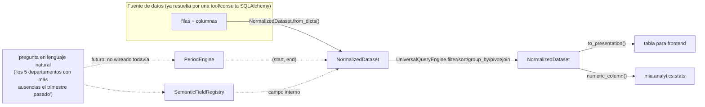
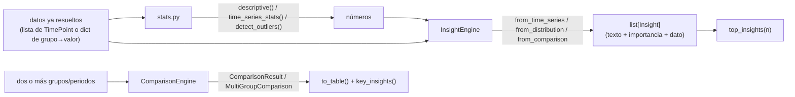

# Arquitectura de consulta universal y analítica

Complementa [`arquitectura.md`](arquitectura.md). Describe dos capas nuevas,
independientes de los dominios transaccionales (`modules/rrhh/*`) y del motor
conversacional (`conversation/engine.py`):

- **`mia/query/`** — capa de consulta universal: representar cualquier
  conjunto de filas de forma uniforme y operar sobre él (filtrar, ordenar,
  agrupar, cruzar) sin SQL dinámico ni acceso directo a la BD.
- **`mia/analytics/`** — capa analítica: estadística descriptiva, detección
  de insights y comparación, sobre datos ya resueltos por una tool.

**Estado real de integración** (para no sobre-afirmar cobertura): hoy
ninguna tool invoca `UniversalQueryEngine`, `SemanticFieldRegistry` ni
`PeriodEngine` en su handler — son infraestructura ya construida y probada
de forma aislada (ver `tests/test_results_algebra.py` y los módulos en sí),
lista para que las tools existentes o nuevas la consuman sin cambiar su
contrato. Lo que **sí** está en producción conversacional son las 4 tools de
`analitica/universal.py` (`analizar_departamento`, `tendencia_metrica`,
`comparar_universal`, `distribucion_plantilla`), que consultan la BD
directamente con SQLAlchemy y usan `mia.analytics.stats`/`insights` para
narrar tendencias y detectar hechos relevantes.

## Por qué dos capas separadas

El objetivo funcional (`FUNCTIONAL_EXPANSION/01_ARQUITECTURA.md`) es que mIA
resuelva preguntas razonables no programadas explícitamente. Dos caminos para
eso que **no** se tomaron:

- Dejar que el LLM genere SQL: descartado — control de acceso y superficie de
  inyección imposibles de auditar con los requisitos de `CLAUDE.md`.
- Añadir una tool especializada por cada pregunta posible: no escala y es
  exactamente lo que ya existe (77 tools) y lo que se quiere complementar, no
  sustituir.

En su lugar: las tools ya construidas siguen siendo el contrato estable con
el LLM (typed params, permisos, auditoría); `mia/query/` es un **DSL
tipado** que una tool puede usar internamente para responder variaciones de
la misma pregunta sin que el LLM toque SQL ni el motor pierda determinismo.

## `mia/query/` — capa de consulta universal

### `NormalizedDataset` (`dataset.py`)

Contrato de datos interoperable: `Schema` (columnas tipadas) + `Row` (dict) +
metadatos de procedencia (`source`, `filters`, `period`, `permissions`,
`notes`, `is_truncated`). No sustituye las presentaciones especializadas
(`Employee360`, panel de departamento); es una representación **adicional**
para cuando una tool quiere que su resultado sea filtrable/cruzable/
exportable de forma genérica.

- `NormalizedDataset.from_dicts(title, rows, labels=...)` infiere el schema.
- `to_presentation()` emite el mismo formato `{type: "table", columns, rows}`
  que ya consume el frontend — cero cambios de contrato en ese lado.
- `clone_with(...)` — inmutabilidad funcional: cada operación del engine
  devuelve un dataset nuevo, el original no se toca.

### `UniversalQueryEngine` (`engine.py`)

Operaciones sobre `NormalizedDataset`, todas deterministas y sin SQL:

| Operación | Qué hace |
|---|---|
| `filter(ds, [FilterClause])` | AND de predicados (`eq`, `gt`, `contains`, `in`, `is_null`…) |
| `select` / `project` | proyección de columnas |
| `sort(ds, by, ascending)` | orden simple o multi-campo |
| `limit(ds, n, offset)` | paginación; marca `is_truncated` |
| `group_by(ds, by, [AggSpec])` | agrupación + `count/sum/mean/median/min/max/distinct_count/std` |
| `pivot(ds, row, col, value, agg)` | tabla de doble entrada |
| `join(left, right, on, how)` | combinar dos datasets por clave (`inner`/`left`) |
| `union([ds...])` | concatenar filas de incompatibilidad compatible |
| `rank`, `add_percentage`, `percentage_change` | columnas derivadas comunes en rankings/comparativas |

Cada `FilterClause(field, op, value)` y `AggSpec(field, func, alias)` es un
dataclass inmutable: el LLM (o código interno) describe la operación con
datos, nunca con una cadena a interpretar como código.

### `SemanticFieldRegistry` (`fields.py`)

Mapea sinónimos en español (p. ej. «sueldo», «salario bruto», «nómina base»)
al campo interno (`gross_salary`) y al dominio al que pertenece. Separa el
vocabulario natural del esquema de datos: añadir un sinónimo no toca ninguna
tool.

### `PeriodEngine` (`period.py`)

Resuelve expresiones de tiempo en español a `ResolvedPeriod(start, end,
label)`: `"hoy"`, `"ayer"`, `"esta semana"`, `"mes pasado"`, `"últimos 3
meses"`, `"Q2"`, `"YTD"`, `"2025"`, `"desde enero hasta marzo"`, `"verano"`.
Stateless — recibe la fecha de referencia en cada llamada, así que es
trivial de testear (`tests/evals/08_temporal.yaml` enumera las variantes que
debe cubrir).

## `mia/analytics/` — capa analítica

Principio: **el código calcula, el LLM narra**. `stats.py`, `insights.py` y
`comparison.py` nunca llaman al LLM ni dependen de `conversation/`; reciben
números ya extraídos por una tool y devuelven estructuras tipadas
(`Insight`, `ComparisonResult`) listas para que el LLM las lea y genere
texto, sin inventar ni recalcular nada.

- `stats.descriptive()` / `time_series_stats()` / `detect_outliers()` /
  `detect_abrupt_changes()` — estadística determinista en Python puro.
- `InsightEngine` — detecta hechos "dignos de mención" (tendencia,
  outlier, cambio brusco) y los puntúa por importancia; `top_insights(n)`
  recorta a los más relevantes para no saturar la respuesta.
- `ComparisonResult` / `MultiGroupComparison` — A-vs-B o N grupos, con
  ganador/perdedor por métrica y `key_insights()` ya redactadas en frases.
- `PredictiveModel` (al final de `analytics/__init__.py`) sigue siendo
  **solo contrato, sin implementación**: un modelo predictivo sobre personas
  empleadas es de alto riesgo bajo el Reglamento (UE) 2024/1689 y requiere
  evaluación legal antes de entrenar nada (ver sección «Predictivo» más
  abajo). Vive aquí, no en `conversation/`, para poder auditarlo o
  desactivarlo sin tocar el LLM ni los dominios transaccionales.

## Tools que ya consumen la capa analítica

`mia/modules/rrhh/analitica/universal.py` (FASE C) añade 4 tools que no
duplican las especializadas existentes (`panel_rrhh`, `comparar_departamentos`,
`tendencia_ausencias`…) sino que generalizan sobre cualquier departamento,
métrica o dimensión:

| Tool | Responde | Motor interno |
|---|---|---|
| `analizar_departamento` | «¿qué está pasando con Cocina?» | `_department_snapshot` + `absence_periods` + `time_series_stats` + `InsightEngine.from_time_series` |
| `tendencia_metrica` | «¿cómo han evolucionado las bajas este año?», YoY opcional | serie mensual/trimestral propia + `time_series_stats` + `InsightEngine` |
| `comparar_universal` | «compara Cocina, Recepción y Pisos por absentismo y ETT» | agregación propia por entidad×métrica + `InsightEngine.from_distribution` |
| `distribucion_plantilla` | «distribución por puesto en Cocina», «¿qué franja de edad predomina?» | `Counter` + `InsightEngine.from_distribution` |

Todas registran `foco_departamento` en el estado de sesión (igual que el
resto de tools de RRHH) para que un follow-up («¿y el trimestre anterior?»)
resuelva el contexto sin repetir el nombre del departamento.

## Gráficos (`modules/rrhh/charts.py`)

`chart_spec()` mantiene exactamente el comportamiento y la firma originales
para tablas de 2 columnas (compatibilidad binaria); se añadió
`chart_spec_multi()` para tablas con 1 columna categórica + N columnas
numéricas (→ `grouped_bar` o `line` multi-serie según si las etiquetas son
temporales). `select_chart_type()` centraliza la heurística de selección
(serie temporal → `line`; pocas categorías → `donut`; ranking largo →
`horizontal_bar`; `hint="distribution"` → `histogram`;
`hint="correlation"` → `scatter`) para que cualquier tool nueva pida un tipo
de gráfico por intención, no por recordar la regla.

## Dónde encaja esto en el turno de conversación

No cambia el flujo descrito en `arquitectura.md`: el LLM sigue eligiendo
tools tipadas y el código sigue siendo quien toca datos. Lo que añade esta
capa es **dentro** de una tool: en vez de escribir una query SQL ad-hoc por
cada variación de pregunta, una tool puede construir un `NormalizedDataset`
una vez y dejar que `UniversalQueryEngine` resuelva filtros/agrupaciones
adicionales que el usuario pida en el mismo turno o en un follow-up.

## Roadmap de integración (pendiente, fuera de esta expansión)

1. Cablear `PeriodEngine` en las tools que hoy reciben `desde`/`hasta` como
   parámetros explícitos (`tendencia_metrica`, `analizar_departamento`), para
   aceptar también la expresión en lenguaje natural sin que el LLM tenga que
   resolver la fecha.
2. Emitir `NormalizedDataset` desde las tools de listado existentes
   (`plantilla`, `buscar_empleado`, `nominas_persona`…) además de su
   presentación actual, para que el resultado de una tool pueda
   re-filtrarse/re-agruparse en un follow-up sin volver a tocar la BD.
3. Evaluar si `SemanticFieldRegistry` debe alimentar la descripción de
   parámetros de las tools (hoy el vocabulario vive en el `description` de
   cada `Field` de Pydantic, duplicado tool a tool).
